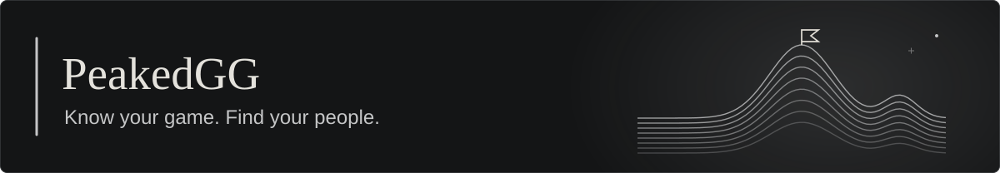
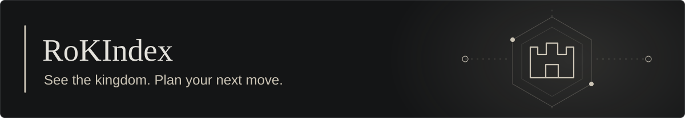

  

<h1 align="center">Little Moonie ☾</h1>

  Full stack developer. Curious about AI. Always building something.

  

  Hey, I'm <strong>@LittleMoonie</strong>. I like turning complicated ideas into things that feel simple. 
  Usually somewhere between an AI workflow, a new feature, and one more idea.

  <a href="#what-im-building">My projects</a> &nbsp; / &nbsp;
  <a href="#my-toolkit">My toolkit</a> &nbsp; / &nbsp;
  <a href="#after-hours">After hours</a>

## What I'm building

These projects are works in progress.

  

**Voeira** is an AI medical co-pilot and electronic health record platform I'm building to connect healthcare professionals and patients.

  

**PeakedGG** is a work in progress combining stats for **League of Legends, Teamfight Tactics, and VALORANT** with gaming community tools. Development is currently paused.

  

**RoKIndex**, formerly **Arcane Kingdoms**, brings management, stats, and analytics to **Rise of Kingdoms**, from individual governors to alliances and entire kingdoms.

## My toolkit

I build full stack products, work with AI and machine learning, and run the infrastructure behind my projects.

**Languages** 
`TypeScript` `JavaScript` `C#` `Python` `Rust` `Dart` `Java` `PHP`

**Web, desktop & mobile** 
`React` `Next.js` `.NET / ASP.NET Core` `Node.js / Express` `Laravel` `Flutter` `Tauri`

**AI & machine learning** 
`PyTorch` `Jupyter` `CNNs` `Reinforcement learning` `AI copilots` `Computer vision / OCR`

**Data & analytics** 
`PostgreSQL` `MySQL` `ClickHouse` `Redis` `Big data`

**Infrastructure & delivery** 
`Docker / Docker Compose` `Kubernetes` `Linux` `VPS hosting` `Distributed workers` `NGINX` `GitHub Actions` `Azure`

I use Rust for performance and Tauri apps, ClickHouse for big data, and VPS infrastructure for websites and distributed workers. My AI work spans copilots for Voeira, CNNs, and reinforcement learning.

<strong>More tools I've worked with</strong>

 

**Interface & UI** 
`HTML` `CSS` `Tailwind CSS` `Bootstrap` `Material UI` `Three.js` `TanStack` `shadcn/ui`

**Backend & storage** 
`Entity Framework Core` `TypeORM` `SQLite`

**Testing & observability** 
`Playwright` `Vitest` `Jest` `xUnit` `Prometheus` `Grafana` `OpenTelemetry`

**Editors & tooling** 
`GitHub` `VS Code` `Visual Studio` `JetBrains`

## After hours

Shows, snacks, a little curiosity, and A LOOOOT more projects

<strong>A hungry little snake lives here.</strong>

 

<strong>A small Moon fact, just because.</strong>

If Earth were the size of a nickel, the Moon would be about as big as a coffee bean. ☕🌕

 

Thanks for stopping by my little corner of the universe. 🌙

